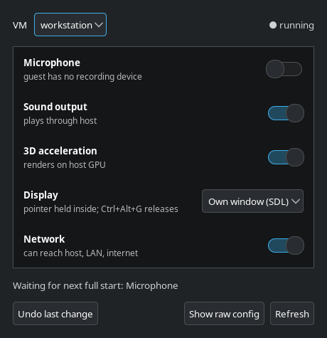

# VM switches



VM switches shows the security- and display-relevant settings of a libvirt virtual machine as five switches, and changes them without hand-editing XML.

| Switch | Values | What it controls |
|---|---|---|
| Microphone | on, off | Whether the guest has a recording device. Off gives the sound card a playback-only codec. |
| Sound output | on, off | Whether the guest has a sound card at all. |
| 3D acceleration | on, off | Whether the guest renders on the host GPU through virgl. |
| Display | Own window (SDL), Own window (GTK), virt-manager | A QEMU window on the desktop, of either kind, or a SPICE display shown inside virt-manager. |
| Network | on, off | Whether the virtual network cable is plugged in. |

Each row states what its current value means. A change is stored at once and takes effect at the next full shut off and start of the VM; while a VM runs, the window lists the switches that are waiting for that restart.

## Requirements

- Linux with libvirt and the `virsh` command.
- Python 3.9 or newer.
- For the window: GTK 3 and its Python bindings. A machine with virt-manager installed already has them.

| Distribution | Packages |
|---|---|
| Arch and derivatives | `python-gobject gtk3 libvirt` |
| Debian, Ubuntu, Mint | `python3-gi gir1.2-gtk-3.0 libvirt-clients` |
| Fedora | `python3-gobject gtk3 libvirt-client` |

The tool installs nothing, needs no root, and runs on the machine that hosts the VMs.

## Run

```sh
git clone https://github.com/d-harbinger/vm-switches.git
cd vm-switches
./vm-switches
```

To add it to the application menu, and to take it out again:

```sh
sh install.sh
sh install.sh --remove
```

The menu entry points at the cloned folder, so the folder has to stay where it is.

The same switches work from a shell:

```sh
./vm-switches list
./vm-switches show workstation
./vm-switches set workstation mic off
./vm-switches undo workstation
```

`mic`, `sound`, `accel3d` and `network` take `on` or `off`. `display` takes `sdl`, `gtk` or `spice`.

## What a change does

Every change reads the stored definition of the VM, edits it, saves the previous definition, and hands the new one to libvirt. If libvirt rejects it, the stored definition stays as it was.

- **Undo.** The previous definitions are kept in `~/.local/state/vm-switches/`, readable only by the owner, twenty per VM. Undo restores the newest one.
- **Own window.** Both kinds remove the SPICE display and the devices that only exist with it (shared clipboard channel, USB redirection), point audio at PipeWire or PulseAudio, and pass the desktop session's display name to QEMU. Run the tool inside the desktop session so it can read that name.
- **SDL or GTK.** The two kinds differ in how they take the pointer. The SDL window holds the pointer whenever it is inside the window and lets go when it touches the window edge. The GTK window holds it only after a click. In both, Ctrl+Alt+G releases it. libvirt has no GTK display type, so the tool passes it to QEMU as a raw `-display` argument; whether the GTK window shows a picture with 3D on depends on the host's graphics driver.
- **virt-manager.** This display uses a private socket, not a TCP port, and restores the shared clipboard channel.
- **3D on a virt-manager display.** The picture is rendered on the GPU and then copied to the viewer, which can tear. The own-window display avoids the copy.
- **System VMs.** A VM under the system connection runs as another user and cannot open a window in the desktop session, so its Display switch is fixed.
- **Sound models.** Only the `ich6` and `ich9` sound cards have a playback-only codec. For other models the Microphone switch is fixed; turning Sound output off removes the card.

## Risk to know about

3D acceleration lets the guest's graphics commands run through host code, which widens what a hostile guest could attack. Leave it off for a VM that exists to contain untrusted software.

## Tests

```sh
python3 -m unittest discover -s tests
```

The tests cover the switch logic and the change and undo flow on sample definitions. They do not start a VM.

## License

MIT. See `LICENSE`.
